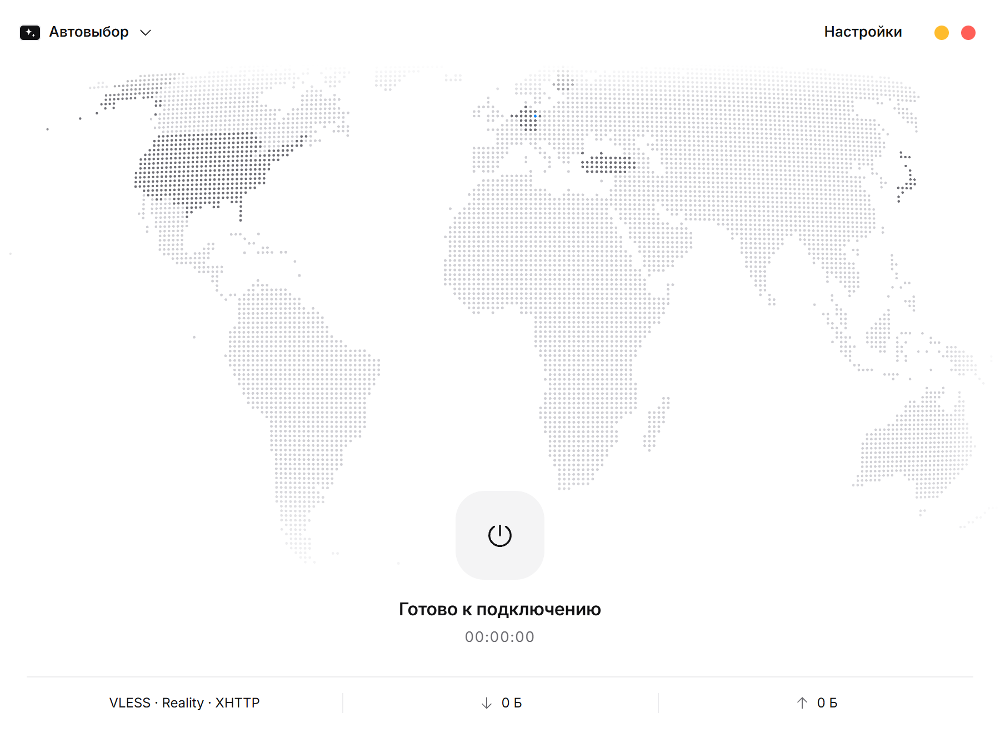
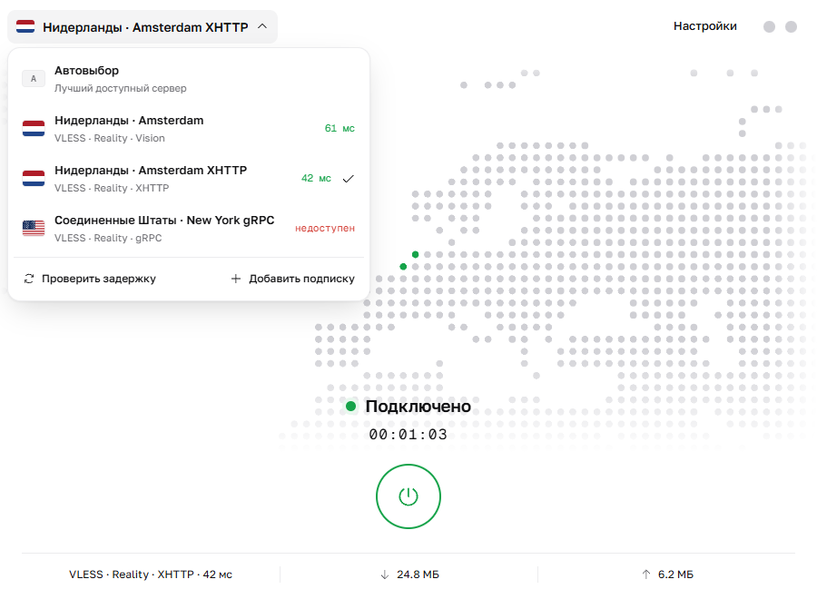
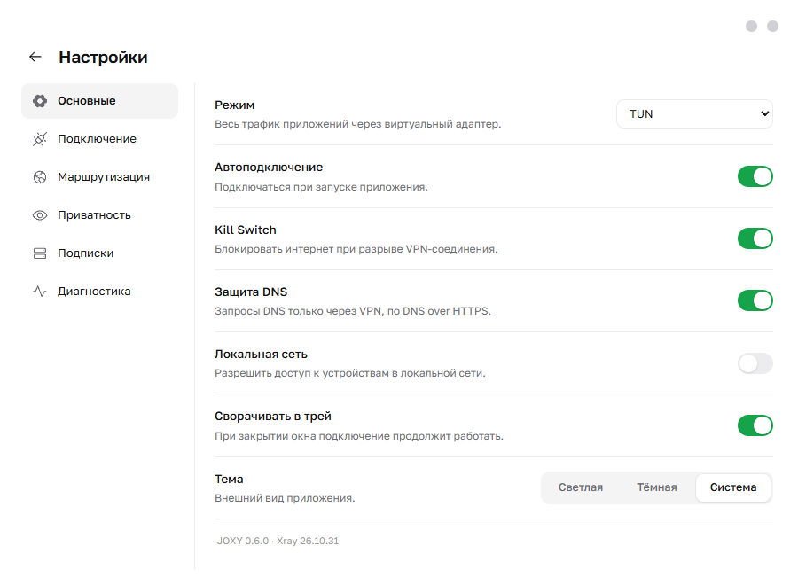

# JOXY

**English:** JOXY is a minimal VPN client for Windows built on [Xray-core](https://github.com/XTLS/Xray-core). Add a VLESS subscription, pick a location on a dotted world map, press one button. It supports system proxy, local proxy and TUN mode with a kill switch, keeps your profiles encrypted with Windows DPAPI and hides server addresses on screen by default. Download the portable `.exe` from [Releases](https://github.com/ChaChaCode/joxy/releases). MIT licensed.

---

Простой VPN-клиент для Windows на ядре Xray. Добавьте подписку, выберите локацию на карте и нажмите одну кнопку.

<p align="center">
  
  
</p>

## Скачать

Последняя версия — на странице [Releases](https://github.com/ChaChaCode/joxy/releases): файл `JOXY-<версия>-Windows-x64.exe`. Это переносимая программа, установка не нужна. Рядом лежит `SHA256SUMS.txt` для проверки файла.

Требования: Windows 10 или 11, 64-бит.

> Файл не подписан сертификатом издателя, поэтому при первом запуске Windows SmartScreen может предупредить о неизвестном издателе. Нажмите «Подробнее» → «Выполнить в любом случае», если скачали файл отсюда и контрольная сумма совпадает.

## Как пользоваться

1. Запустите JOXY и вставьте ссылку на подписку (`https://…`), ссылку `vless://` или Xray JSON.
2. Слева вверху выберите локацию или оставьте «Автовыбор».
3. Нажмите круглую кнопку. Выбранная страна загорится зелёным на карте; страны, где у вас есть серверы, всегда отмечены более тёмными точками.

Карту можно перетаскивать и приближать колесом мыши, двойным щелчком или клавишами `+`/`−`; `0` возвращает вид.

## Возможности

- **Три режима:** системный прокси Windows, локальный HTTP/SOCKS-прокси и **TUN** — весь трафик приложений, включая UDP, через виртуальный адаптер.
- **Kill switch** в режиме TUN: если VPN пропадёт, интернет блокируется до переподключения. Правила Windows Filtering Platform живут ровно столько, сколько работает JOXY, поэтому оставить систему без интернета он не может.
- **Переподключение** при потере связи, смене Wi‑Fi/кабеля и после сна; резервный сервер, если основной недоступен.
- **Протоколы:** VLESS с REALITY или TLS; транспорты Vision, XHTTP, gRPC, WebSocket, HTTPUpgrade; TLS-фрагментация.
- **Подписки:** срок действия, трафик и ссылки поддержки провайдера, фоновое обновление при запуске.
- **Раздельное туннелирование:** домены и подсети, которые идут напрямую.
- **DNS:** DNS over HTTPS через VPN и защита от утечек DNS в TUN; блокировка или туннелирование IPv6.
- **Приватность:** профили зашифрованы Windows DPAPI; адреса серверов и внешний IP скрыты на экране; JOXY не обращается к GeoIP и аналитике.
- Светлая, тёмная и системная тема; автоподключение при запуске; сворачивание в трей.

## Режим TUN и права администратора

Чтобы создать сетевой адаптер, Windows требует права администратора. Когда выбран TUN, JOXY сам перезапускается с правами при запуске — Windows покажет обычный запрос UAC. Если отказаться, JOXY запомнит это и предложит снова только при нажатии кнопки подключения.

Если на компьютере работает другой VPN в режиме TUN, JOXY сообщит об этом: два TUN одновременно конфликтуют, поэтому другой VPN нужно отключить.

<p align="center">
  
  
</p>

## Сборка из исходников

Нужны Node.js 24, Go 1.25 и PowerShell.

```powershell
npm ci
npm run fetch:core   # скачивает Xray-core и Wintun и сверяет их SHA256
npm test
npm run pack         # собирает интерфейс, помощник kill switch (Go) и portable .exe
```

Готовый файл появится в `release-joxy-<версия>/`. Скрипт `build.ps1` делает то же самое и при необходимости скачивает отдельный Node.js 24, не трогая установленный.

Полезные команды: `npm run dev` — интерфейс в браузере, `npm run verify:ui` — проверка интерфейса через Playwright, `npm run shots` — скриншоты.

## Устройство

- `electron/` — главный процесс: подписки и профили, управление Xray, системный прокси, TUN, kill switch, переподключение.
- `src/` — интерфейс на React: карта (`WorldMap.tsx`), главный экран (`App.tsx`), настройки (`SettingsView.tsx`).
- `guard/` — `joxy-guard`, помощник kill switch на Go (Windows Filtering Platform, динамическая сессия).
- `resources/` — скрипты Windows для прокси и восстановления TUN; сюда же `fetch:core` кладёт Xray и Wintun.
- `scripts/build-world-dots.mjs` — сборка точечной карты из данных Natural Earth.
- `docs/` — заметки по архитектуре и скриншоты; `CHANGELOG.md` — история версий; `DESIGN.md` — принципы оформления.

## Лицензия

JOXY распространяется по лицензии [MIT](LICENSE). Сторонние компоненты — Xray-core (MPL-2.0), Wintun, Electron, React, шрифты Golos Text и Geist Mono (OFL), иконки Phosphor и флаги flag-icons (MIT), данные Natural Earth (общественное достояние) — используются по своим лицензиям, см. [THIRD_PARTY_NOTICES.md](THIRD_PARTY_NOTICES.md).

JOXY — независимый проект. Он не содержит кода Throne или nekoray и не связан с XTLS.
